This report describes a lab which uses one seven-segment SystemVerilog module to light up a double seven-segment display, by alternating between lighting them at 100Hz (faster than the human eye can detect). The lab also includes a scanner for a keypad, where signals are put through each of the rows and if a column is pressed, an LED lights up. This lab took me about 18 hours to complete. One thing that would help a future version of this lab is a better diagram or explanation of how the scanner for the keypad is working, because the current figure seems misleading.  

### Hardware Specifications
The FPGA pins are in series with resistors from Radiant, which are 100K. The scanning signals appear in each of the columns when the LEDs are pressed, working even when multiple buttons in the same column or the same row are pressed. 

### Verilog Structure and Style
This lab was done in two separate LatticeRadiant build projects. The counter module uses the same code between projects, so it is only displayed once.
The first project is the seven-segment decoder, which only includes a single seven-segment module that is time multiplexed. 

 Click to view top-level seven-segment module 

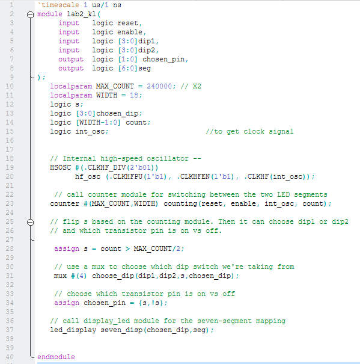
Includes: HSOSC, one seven-seg module, multiplexed counter module, and assign statments to implement multiplexing. 

 Click to view seven-seg module 

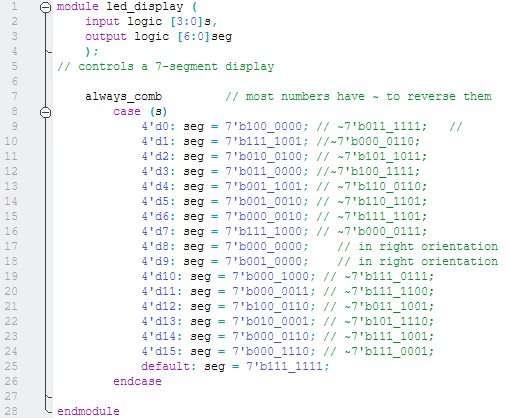
This was used in Lab 1, with updates made to the code for Lab 2.

 Click to view the mux module 

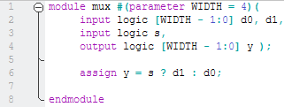

 Click to view counter module 

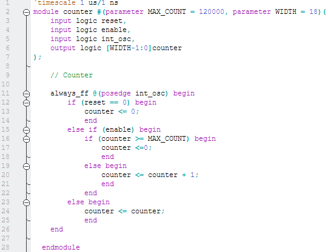

The second project is the keypad project which scans through the rows of the keypad. 

 Click to view top-level keypad module 

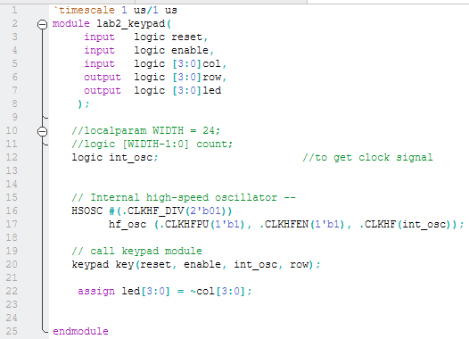
Includes: scanning module (my module name: keypad), and assign statments to light up the LEDs based on the column outputs. 

 Click to view scanning module 

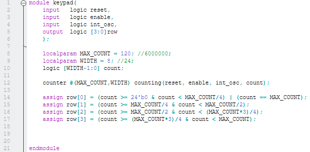
Includes: counter and assign statements. The counter is resettable and enable-able, therefore, so is the scanning module.

### Simulations and Waveforms 
Questa was used for simulations with testbenches for all new modules. 

The first waveform is for the seven-segment LED showing the multiplexing functionality of the module. The waveform shows that when s changes, chosen_dip changes between dip1 and dip2 (the two switches that send the signals to the two different seven-segment displays).  

 Click to view dip1, dip2, and chosen_dip waveforms 

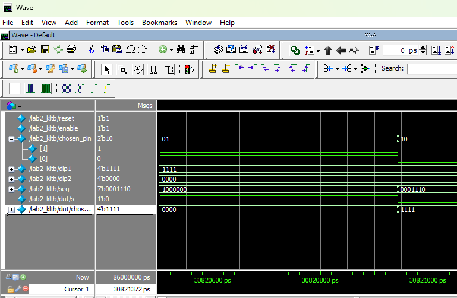

The second set of waveforms is for the scanning module. The first attacment demonstrates that the rows alternate, while the second two attachments display the reset and enable features. 

 Click to view alternating row waveforms 

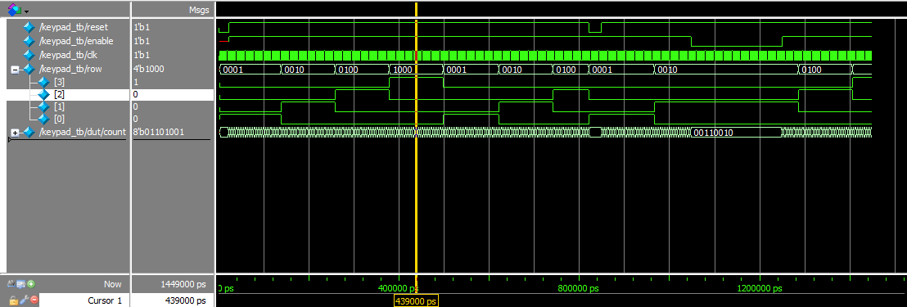

 Click to view reset and enable features for the counting module in waveforms 

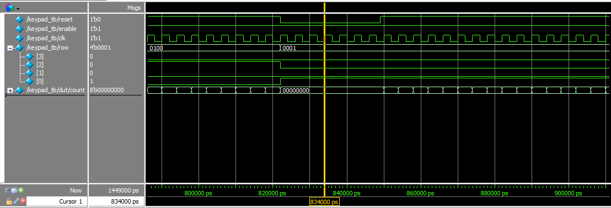
This is the reset feature. When reset is pressed, the row signal returns to its default state, jumping from 0100 to 0001. 

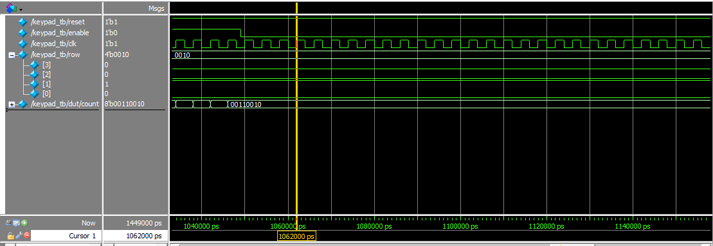
This is the enable feature. When enable is pressed, the row signal holds the current signal it was at when enable was pressed until enable is let go. 

The final set of waveforms is from the top module of the keypad project. The following four attachments demonstrate the LED driving functionality of the top module. 

 Click to view LED waveforms 

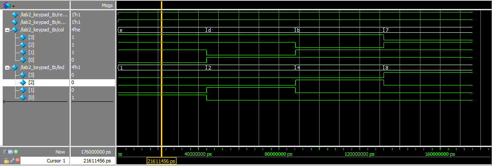
LED[0] is on

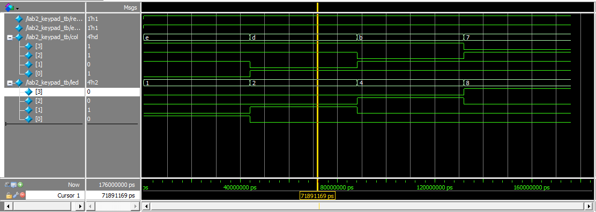
LED[1] is on

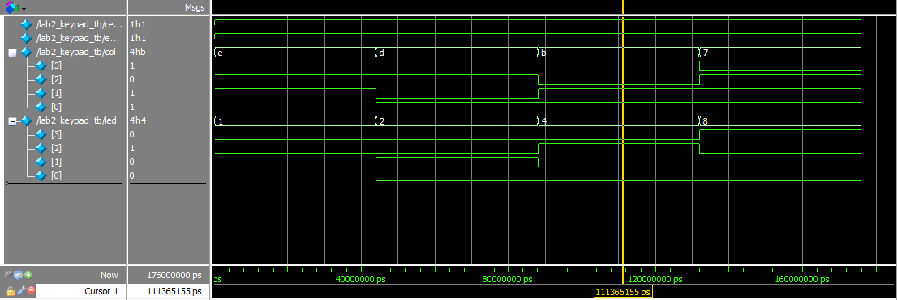
LED[2] is on

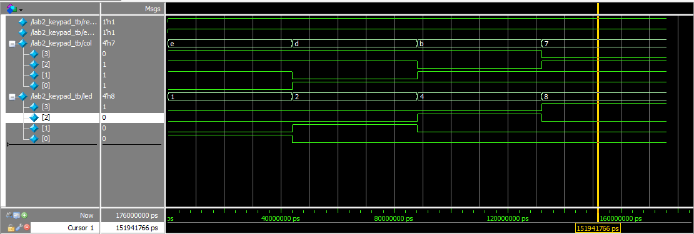
LED[3] is on

### Block Diagram Specs
The first block diagram is for the first project (double seven-segment LED).  

 Click to view the first block diagram 

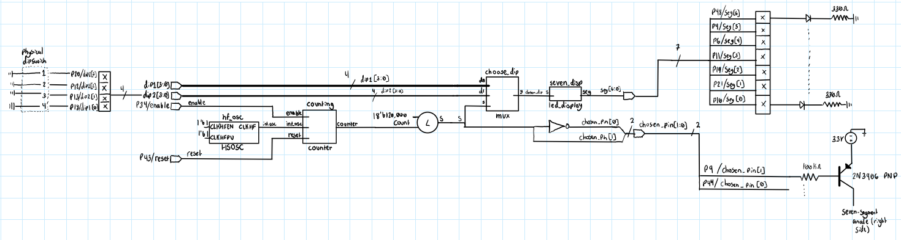

The second block diagram displays the second project (the keypad).   

 Click to view the first block diagram 

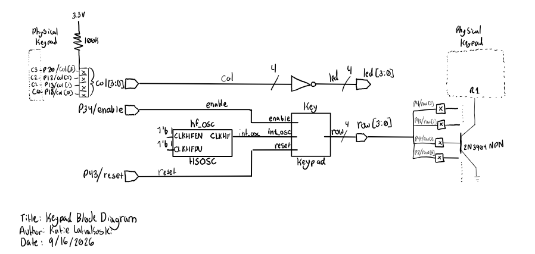

### Calculations
The first schematic shows how the FPGA pins are in the reccomended operating ranges (calculation done for the FPGA pin connected to the PNP transistor connected to the seven-segment LED).  

 Click to view FPGA pin calculation 

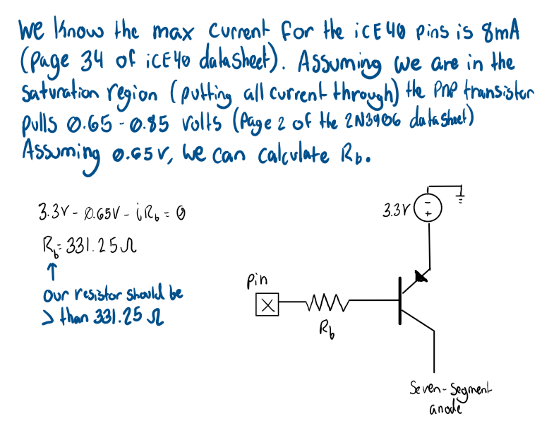

### AI Prototype

My reflection on the outcome of this might be fairly standard. The output was better when given the extra file and info. Therefore, when coding using an LLM, it might be helpful to give it as much information as possible, so that it can work within your constraints better. I think the one downside of this is that it doesn't allow the LLM as much ingenuity. For example, if you specified a constraint of using combinational logic in a certain case, but the LLM actually has seen a use-case of something else that implements your desired design better, then you would probably want to see that. 