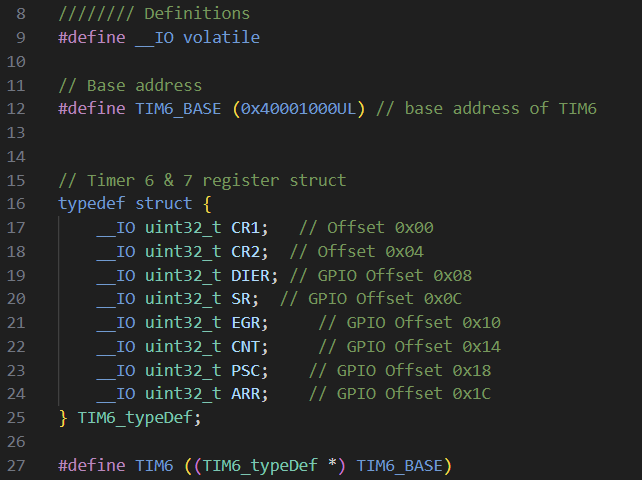
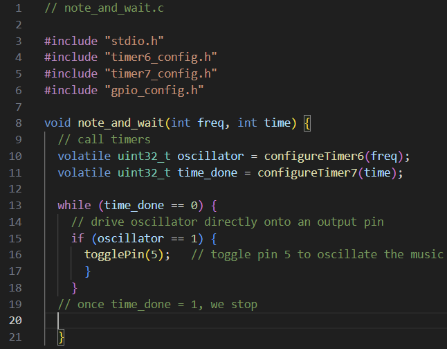
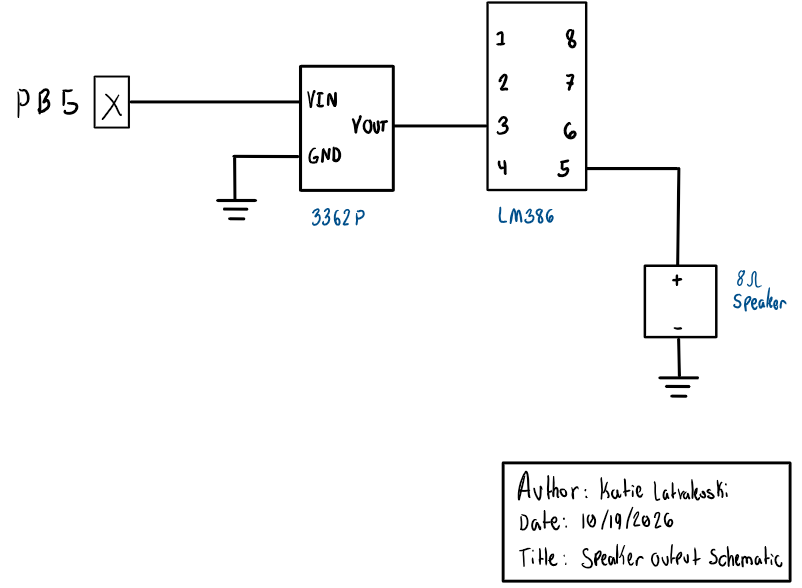

This report describes a lab which uses the STM32L432KC MCU  timers to play music given a matrix structure of notes and the number of milliseconds that the notes are played for. This lab took me about 24 hours to complete. This lab meets all of the design specifications listed on the E155 website. 

### Hardware Specifications
The setup can play a set of musical notes with rests at the correct pitches and for the correct amount of time. It utilizes the 3362P 10K potentiomter to control the volume of the speaker that outputs the music and an LM386 audio amplifier to limit the amount of current that the speaker pulls from the MCU. 

### Software and Microcontroller Design
This lab uses two timers, timer 6 and timer 7 with custom header files to access all of the registers from memory using structures. An example of the structured register access is included below. All other code can be found in my [lab 4 GitHub repository](https://github.com/klatvakoski/katie_speaker_lab4).  

 Click to view an example of the structured register access for Timer 6 

 

### Timer functionality 
#### Timer 6
Timer 6 was used to produce a wave at a specific frequency. This wave was output directly to pin, PB6, which then input that signal into the LM386 audio amplifier, and subsequently the speaker. Timer 6 is driven by the MSI oscillator at 4 MHz, and configured using the PSC prescaler to drive it at 1 MHz. A maxcount value is determined for each desired frequency using the following equation:
$$
\mathrm{maxcount} = \frac{1 \mathrm{ MHz}}{f_{des}}
$$

The maxcount is computed as integer division, so any decimal portion will be truncated. This is so that the timer only counts in whole numbers, meaning that it wouldn't be able to reach the maxcount value if it had decimal numbers in it. Unfortunately, this does produce some error in outputed wave, which is calculated. For example, when the timer is asked to produce a 220 Hz signal, it will have some error: 
$$
\text{maxcount} = \frac{1 \mathrm{ MHz}}{220 \mathrm{ Hz}} \\
                        = 4545.455 \\
$$ 
Truncated, this gives maxcount = 4545. We can then find the wave this produces by dividing 1 MHz by the 4545, and finding the true frequency of the wave that's being output. Once that's done, the error can be found taking the absolute value of the difference between the expected wave frequency and the real wave frequency, all divided by the expected wave frequency: 
$$
f_{\mathrm{real}} = \frac{1 \mathrm{ MHz}}{4545} \\
                        = 220.022 \\

\text{percent error} = \frac{220.022 \mathrm{Hz} - 220 \mathrm{Hz}}{220 \mathrm{Hz}}*100\% \\
                            = 0.01 \% \\
$$ 
This error can be found for each note that is played in Fur Elise. These can be found in the following [spreadsheet](https://docs.google.com/spreadsheets/d/1LlO74CX2zvYxKUV85WB15bZL7Il-8ns_/edit?usp=sharing&ouid=103245042396860123175&rtpof=true&sd=true). All of the errors are highlighted in green, as they have less than 1% error. It is not enough to check that 220 and 1000 Hz have a less than 1% error, because there are values that are higher than 1000 Hz that might cause more error because it is a higher divisor. 

The minimum producible frequency is anything between 0 and 1 Hz. This would cause a number that is higher than the highest number that the timer can count to (1,000,000), which would cause the output frequency to be incorrect. The maximum produceable frequency within 1% error is 10,001 Hz, which can be found with this MATLAB code: 

        %setup: 
        frequencies = (1:1:1000000); % frequencies to test
        tim_cnt = 1000000; % max number the timer can count to

        % checks for the value where the max freq has >= 1% error
        for i = 1:length(frequencies)
            maxcount = fix(tim_cnt/frequencies(i));
            f_real = tim_cnt/maxcount; 
            error = abs(f_real - frequencies(i))/frequencies(i) * 100; % errror
            if error >= 1
                max_freq = frequencies(i);
                break
            end  
        end 

#### Timer 7
Timer 7 was used to count the number of seconds for a note (or a rest) to be played. This is essentially like a waiting timer, which counts while timer 6 plays the specific frequency. The timer is driven by the MSI 4 MHz clock, so it has a max count of 4,000,000. Therefore, the minimum number of seconds that it can play for are 0 seconds and it can play for a maximum of 4,000 seconds. 

#### Timer 6 and Timer 7 Interactions
Timer 6 and Timer 7 interact in a simple function called note_and_wait, which calls both of the timer functions and drives the output of timer 6 to the GPIO pin. 

 Click to view note_and_wait 

 

### Schematic 
The schematic for the speaker is included below: 
 

### AI Prototype
I used Gemini, which was fairly helpful. It chose a different timer than I did, stating that TIM2 would be the best choice. It chose that because it knew all of the information and setup steps in order to configure timer 2 to best work and because timer 2 can directly drive a GPIO output, while I wanted to use TIM6 and TIM7 because they were easier for me to understand. It told explained almost all of the correct registers to enable, however it recommended using an 80MHz PLL to drive the timer, but 1) didn't explain how to configure the PLL and 2) ended up dividing by 80 using the prescaler inside the timer, so it seemed like an odd choice to use PLL. As the answers were all correct, I didn't feel the need to attach the reference manual. 

I think that the most useful thing it could do was find all the steps to configure all the specific registers, because it is easy to miss a couple steps when doing the lab, which will cause the entire system not to work. However, because it also missed some steps and made some questionable decisions, that could cause more work (like using the PLL), I think that it is still useful to look in the reference manual yourself to at least get a tentative idea of the different functionalities. 